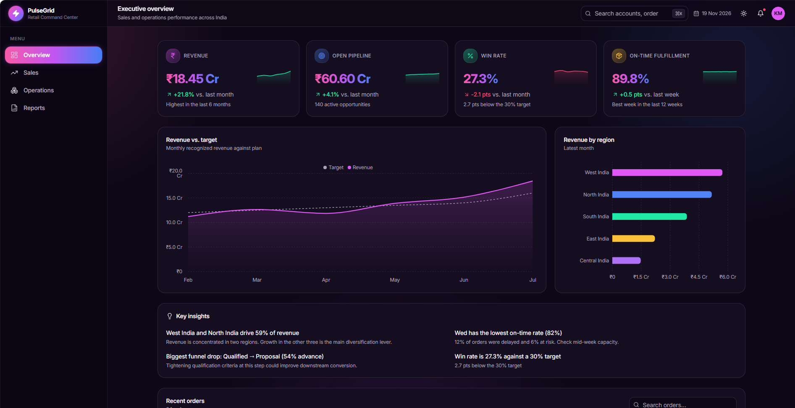

# PulseGrid: Sales & Operations Analytics Dashboard

An interactive dashboard for a fictional consumer goods distributor
operating across India. It tracks revenue, sales pipeline, win rate and
order fulfillment, and turns them into plain-language insights.

**Live demo:** https://sales-ops-dashboard-gamma.vercel.app

> **About the data:** all data is **simulated** (see
> `src/data/mockData.ts`). The company, customers and figures are
> fictional, so the findings below illustrate the analysis, not real
> business results.



## What this project demonstrates

- **KPI design:** four headline metrics, each with a written definition
  (below), a comparison period and a target where relevant
- **Single source of truth:** every KPI is *computed* from the underlying
  data in `src/lib/metrics.ts` and `src/data/kpis.ts`, never typed in by
  hand, so the cards, charts and tables always agree
- **Data validation:** automated tests check the formulas and confirm that
  the dashboard numbers reconcile with the raw data (`npm test`)
- **Insight generation:** a "Key insights" panel turns the data into
  findings (concentration, weak spots, funnel drop-off)
- **Dashboard UX:** loading states, search, sorting, pagination, light and
  dark themes, responsive layout, accessible controls

## Metric definitions

| Metric | Definition | Latest value |
|---|---|---|
| **Revenue** | Recognized revenue for the month (₹). Delta = (this month − last month) ÷ last month | ₹18.45 Cr, +21.8% |
| **Open pipeline** | Total value of deals in open stages (Discovery → Negotiation). **Excludes** Closed won | ₹60.60 Cr, 140 deals |
| **Win rate** | Won ÷ (won + lost) deals closed in the month. Target 30%. Delta in percentage points | 27.3%, 2.7 pts below target |
| **On-time fulfillment** | Share of orders delivered on time over the last 7 days, **weighted by daily order volume**. Delta in percentage points vs. last week | 89.8% |
| **Stage conversion** | Deals in the next stage ÷ deals in this stage | See insights panel |
| **Regional share** | Region's share of the latest month's revenue | West 31%, North 28% |

## Key findings (on the simulated data)

1. **West and North India drive 59% of revenue.** Growth in the other
   three regions is the main diversification lever.
2. **Wednesday has the weakest fulfillment** (82% on time, 12% delayed,
   6% at risk), which points to a mid-week capacity issue.
3. **The biggest funnel drop is Qualified → Proposal** (about 54% advance),
   so tighter qualification at that step could lift later conversion.
4. **Win rate is 2.7 points below the 30% target** and slipped 2.1 points
   month over month.

## Known limitations

- Data is simulated; there is no backend or database
- Stage conversion treats a snapshot of the funnel as if it were a
  cohort. A rigorous funnel analysis would track the same deals over time
- There is no real authentication (sign out goes to a demo page)

## Tech stack

React 18, TypeScript, Vite, Tailwind CSS, shadcn/ui (Radix), Recharts,
Framer Motion, React Router, Vitest.

## Run it locally

```bash
npm install
npm run dev     # http://localhost:5173
npm test        # formula and reconciliation tests
npm run build   # type-check and production build
```

## Project structure

```
src/
├── lib/
│   ├── metrics.ts        # KPI formulas (pure functions)
│   └── metrics.test.ts   # unit + reconciliation tests
├── data/
│   ├── mockData.ts       # simulated raw data
│   ├── kpis.ts           # KPIs computed from the raw data
│   └── insights.ts       # insights generated from the data
├── components/           # charts, KPI cards, tables, layout, UI primitives
├── pages/                # Overview, Sales, Operations, Reports
└── types/                # shared TypeScript types
```

## Roadmap

- Replace the simulated data with a real public dataset, with a documented
  Python/SQL cleaning step
- Date and region filters with drill-down
- Cohort-based funnel analysis instead of snapshot conversion
